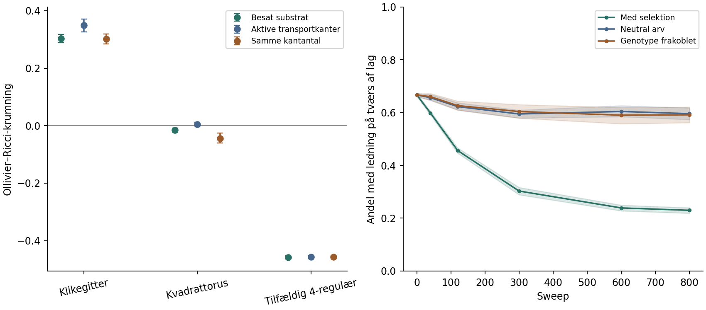
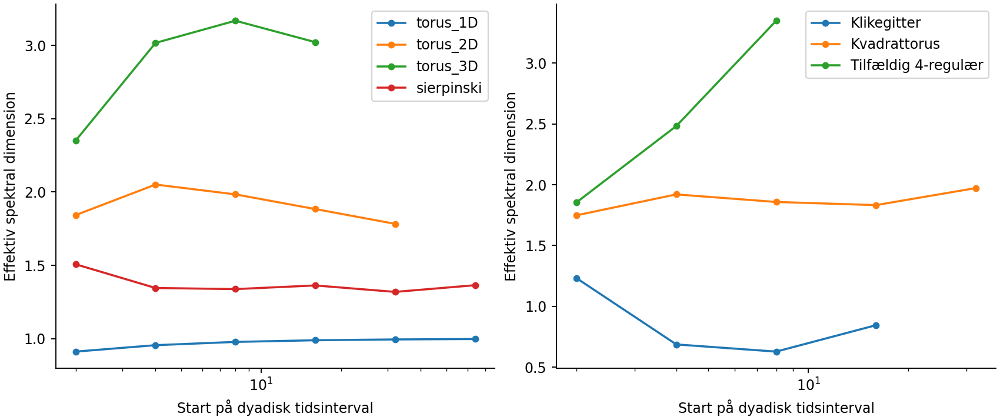

# Hvad kan evolution selektere i en effektiv rumtidsgeometri?

*Forskningsrapport, 25. november 2026.*

**Den stærkeste positive observation er en miljøafhængig selektion for færre transportretninger.** På et 3D-gitter med lagdelte ressourcer blev evnen til at transportere energi på tværs af lagene sjældnere, og effekten fulgte ressourcernes akse, da vi roterede dem. **Den stærkeste negative observation er, at den tilsyneladende konvergens mod flad geometri i Skovlaboratoriet ikke overlevede et forsøg med stærkere begyndelseskrumning og samme nabograd.** Ingen af disse to resultater etablerer en relativistisk rumtid.

## Forsøgsdesign

Vi målte først den fælles skovmotor fra `cb587788`, uden at ændre kamp, vækst, vedligehold, energipulje eller kompatibilitetsregel. Der var tre udgivne substrater, tre størrelser og 12 seeds per kombination, både med og uden mutation. Derefter kørte vi samme motor i en forskningsharness på tre gradmatchede substrater i to størrelser. Kvadrattorussen er lokalt flad i målet nedenfor. Kligenetværket er en ring af grupper af fem, sammensyet af få broer. Det negative substrat dannes af to kantdisjunkte Hamiltonkredse, hvilket giver et 4-regulært lokalt træagtigt netværk. Alle tre har samme antal nabokanter for samme størrelse. De sidste to er grafkontroller med foreskrevne topologier. Skovmotoren udfører i alt 360 forløb til sweep 260 i disse to serier.

En kant leder energi, når begge pladser er levende, og deres arvelige strategier er kompatible. Underliggende geometri holdes fast, mens de aktive kanter ændres. Kontrollerne fryser startens artsmærkater, blander de aktuelle mærkater med uændret artsfordeling, åbner alle kanter mellem de aktuelt besatte pladser, eller trækker tilfældige kanter mellem de besatte pladser med samme kantantal. Mutationsfri kørsel er en særskilt kontrol. Selektion kan fortsat virke på den oprindelige variation.

Vi målte Ollivier–Ricci-krumning \(\kappa(i,j)=1-W_1(\mu_i,\mu_j)\) på op til 96 frøfast valgte kanter per graf. Her holder den dovne random walk halvdelen af sandsynligheden hjemme og fordeler resten ligeligt på aktive naboer. Nabokanter har grafafstand 1. Vi løste det diskrete transportproblem ved præcis heltallig tildeling for de valgte kanter. Positiv \(\kappa\) betyder, at nabofordelingerne ligger tættere end deres startsteder. Det er et mål for grafens lokale transport, og den rumlige Ricci-tensor i en Lorentz-metrik er en anden størrelse. [Ollivier](https://doi.org/10.1016/j.jfa.2008.11.001)

For den største komponent beregnede vi den gennemsnitlige retursandsynlighed \(P(t)=\operatorname{Tr}(T^t)/n\) og den dyadiske hældning \(d_s(t)=-2\log[P(2t)/P(t)]/\log2\). Vi brugte fuldt spektrum til og med 500 celler og en frøfast estimatorsporberegning på større grafer. Når slutværdien af \(P\) var under fire gange komponentens endelige returplateau \(1/n\), blev intervallet fravalgt. Et enkelt decimaltal fra ét tidsinterval klassificeres som en målbar hældning. En fraktal kræver et ikke-heltalligt skaleringsområde, der vokser eller består ved forfinelse og større systemstørrelse. Som kalibrering brugte vi 1D-, 2D- og 3D-tori og en Sierpiński-graf, hvor den spektrale dimension i den relevante grænse er \(2\log(3)/\log(5)\approx1,365\). [Barlow & Perkins](https://doi.org/10.1007/BF00318785)

## H1 og H2 · Geometri ændres, men begyndelsesgeometrien kan bestå

På den almindelige flade 20×20-torus voksede den største aktive komponent fra omtrent 8 til **263** pladser. På sweep 260 gav en frossen startmaske omtrent 7 og ommærkning med aktuelle artsstørrelser omtrent 225. Det viser, at skovens arvelige konkurrence skaber en ændret, rumligt organiseret transportgraf. Den frosne kontrol viser behovet for dynamik. Ommærknings- og kantantalskontrollerne viser også, hvorfor et større netværk alene hverken afgør selektion eller krumning.

På standardgitrene ved \(L=20\) endte middelkrumningen i den aktive graf på **0,0000**, **0,0095** og **−0,0081** for henholdsvis den negativt mærkede, flade og positivt mærkede variant. De tre fulde startgitre havde i dette mål omtrent samme krumning allerede fra begyndelsen, fra −0,016 til 0. Derfor udfordrede vi forklaringen med andre begyndelsesgrafer:

| Gradmatchet substrat | Aktiv krumning ved sweep 260 | 95 % seedinterval |
|---|---:|---:|
| Klikegitter | +0,349 | [0,326; 0,372] |
| Kvadrattorus | +0,005 | [−0,001; 0,012] |
| Lokalt træagtig 4-regulær graf | −0,458 | [−0,463; −0,452] |

Tallene bruger samme størrelse 20×20, mutationsregime og prøveprotokol. Det positive netværk forblev også langt mere fragmenteret end det negative. Samme kantantal på det besatte substrat fjernede ikke den store forskel mellem familier. Der er derfor **ingen fælles slutkrumning i dette forsøg**. Skovens evolution former, hvilke underliggende kanter der er åbne. Selve underlaget kan ikke arves eller ombygges i originalmotoren. En skarpere H2-test må give forskellige lokale omkoblinger samme reproduktionsmuligheder og lade fortegnene konkurrere under flere miljøer. H2 forbliver åben.

## H3 · Selektion kan foretrække færre retninger, og miljøet bestemmer hvilke

På originale ringgitre nærmede transporthældningerne sig 2 på nogle korte skalaer, men var mindre på længere skalaer. Den træagtige gradmatchede graf nåede omtrent 3,35 på et kort interval og mistede derefter det gyldige målevindue ved mætning. Den har fortsat ingen indlejring som et 3D-rum. Klikegitteret havde en hældning omkring 0,7–0,9 over de rapporterbare tidsskalaer. De målinger falsificerer en fælles effektiv dimension for forsøget og viser, hvordan flaskehalse eller forgrening kan efterligne lave eller høje dimensionstal.

### En lokal selektionskontrol med strengt lokalt energiregnskab

I en adskilt variant på et 3D-torusgitter har hver celle lokal pulje \(Q_i\) og reserve \(E_i\). Upkeep og ressourceoptag flytter energi mellem de to på samme sted. Transport flytter reserve mellem naboceller, når begge arvelige masker tillader den tilsvarende retning. Konkurrence foregår langs de samme seks lokale kanter for **alle** genotyper. Sandsynligheden for at kopiere en konkurrerende nabos genotype afhænger af forskellen i deres reserver. Mutation flipper ét symmetrisk valgt bit. Reglerne indeholder ingen belønning for en bestemt dimension, kantgrad eller krumning. Total \(\sum_i(E_i+Q_i)\) er konstant. Retningerne var tilgængelige på forhånd; den effektive brug af dem kan ændres ved selektion.

Vi kørte 888 forløb over de tre batches, med 12 seeds per betingelse. Sæsonbestemt svag heterogenitet gav små forskelle. I den efterfølgende serie brugte vi en stærkere, statisk ressourcegradient og større følsomhed for reserveforskelle. Der er derfor både en anden ressourcekontrast og en anden selektionsstyrke i den sammenligning. Ensartet miljø gav identiske genotypetidsserier på tværs af de tre kontrolregler. I de stærkt lagdelte miljøer fik vi ved 16³ og sweep 800:

| Mål | Selektion | Neutral arv | Parret forskel [95 %] |
|---|---:|---:|---:|
| Andel med én tilladt akse | 57,7 % | 41,0 % | +16,8 procentpoint [14,5; 19,3] |
| Andel med tilladelse på tværs af lagene | 23,0 % | 59,6 % | −36,6 procentpoint [−39,1; −34,0] |

Den frakoblede kontrol lod fortsat reserver afgøre konkurrencen, men transporten fulgte alle kanter uanset arveanlæg. Her havde **59,1 %** den arvelige tilladelse på tværs af lagene. Dette sammen med den neutrale kontrol peger på samspillet mellem arvet transport og differentiel reproduktion.

Med 12 nye seeds og to modsatrettede startfordelinger lå en-aksetypen omkring **58–59 %** i slutvinduet for de oprindelige lag. Den neutrale kontrol lå henholdsvis omkring **48 %** og **35 %**. Da lagene blev roteret 90 grader, skiftede den mindst hyppige transportretning fra x til y; tilladelsen på tværs af de roterede lag endte ved **23 %** fra begge startfordelinger. Det er reproducerbar, miljøbetinget tilnærmelse i **arvede transportegenskaber**. I et miljø med stærke, kompakte ressourceøer var ændringen i en-aksetypen mindre, **+6,5 procentpoint** [2,8; 10,0]. Der er således konkret støtte til H3 som betinget selektion af transportretninger.

I de lagdelte netværk ændrede transporthældningen sig fra omtrent **1,23** ved intervallet 4–8 til **1,74** ved 64–128, mod **1,41** til **2,41** i den neutrale kontrol i de fire målte 16³-netværk. Dette støtter langsommere flerskalatransport. Hældningen er skalaafhængig og adskiller sig fra Sierpiński-kalibreringens næsten flade plateau. Et aspekt som én tilladt akse hos en genotype er heller ikke det samme som et rent 1D-netværk. Ingen af de kørte serier viser etablering af en ny fysisk rumdimension eller af en specifik fraktal dimension.

## H4 · En tidspil kan måles, mens selektionens ekstra bidrag er åbent

Den tidligere [stationaritetsundersøgelse](../fundamental-physics/followup/RAPPORT.md) fandt en reproducerbar reserveasymmetri efter lang indbrænding i fællesmotoren. Den isolerede ikke naturlig selektion fra den irreversible rækkefølge af optag, vedligehold, vækst og død.

I den nye variant med statiske ressourcer brugte vi kvartilord ved lag 2, 8 og 16 med seks holdout-seeds inden for hver betingelse og kvartilgrænser fælles for kontrolreglerne. Vi sammenlignede sene vinduer og lavede også et følsomhedstjek med lineær detrending, som kommuterer med tidsvending. Især i lagmiljøet har reserve middelværdidrift i det sene vindue. Både de neutrale og frakoblede kontroller kan give fremadrettet logscore. Der er her **ingen robust påvisning af, at selektion forstærker tidspilen**. H4 bevares særskilt fra fundet af observeret asymmetri i originalmotoren.

## H5 · En fælles optisk metrik er mulig, men signaltid bestemmer ikke egentid alene

En konkret testbar ansats på en langsomt varierende graf er
\[
ds^2=-c^2N_i^2dt^2+dl^2,qquad d\tau_i=N_i\,dt,\qquad
\Delta t_{ij}=\frac{\ell_{ij}}{c\,N_{ij}}.
\]
Et lokalt ur ved en celle måler \(\tau_i\). En uafhængig mekanisk eller akustisk signalprobe skal teste \(c\) i den samme lokale ur- og længdeskala. En målt transport- eller reproduktionstid er i første omgang en dynamisk tidsskala.

På 36 aktive skovgrafer lagde vi to foreskrevne optiske beskrivelser oven på samme graf. Ændr hvert \(N_i\) med en lokal faktor, og gang kantens længde og kantens lapse med samme geometriske middel af nabocellernes faktorer. Alle signalers korteste ankomsttider var de samme til **\(1,8\times10^{-15}\)**, og det lokale \(c\) var stadig 1,7. De rumlige korteste afstande ændredes med op til **9,37**, mens to lokale ure kunne afvige med en faktor **2,33**. Det er en diskret, numerisk demonstration af konform tvetydighed. Ingen af de to ure fremkom ved selektion. Signaltider måler den optiske geometri, mens uafhængige lokale ure er nødvendige for at skelne modellerne.

Et positivt H5-forsøg bør lade to uafhængige, materielle urtyper og to typer lokale signalpakker måle samme \(N_i\), \(\ell_{ij}\) og \(c\) efter grovkornning af en selekteret tilstand. Det kræver forudsigelser for ursammenligninger, signalernes lange bølgelængder og en kontrol med frossen geometri. Den [dispersive bølgereference](../fundamental-physics/matter/README.md) viser, hvordan en målt isotrop bølgehastighed kan bryde sammen ved korte bølgelængder på samme gitter. Lorentzisk kausalitet, tid og rum skal i et videre forsøg passes med fælles parametre på tværs af uafhængige målinger. [Unruh, fysisk analog med lokal lydhastighed](https://doi.org/10.1103/PhysRevLett.46.1351)

## Prioritet efter denne runde

1. **H3.** Test den roterbare selektion af transportretninger i større systemer og ved flere ressourcekontraster. Det er det tydeligste nye positive resultat med uafhængige evolutionære kontroller.
2. **H2.** Lad nærliggende omkoblinger være arvelige og anvend de positive og negative nulmodeller, som allerede adskiller sig på måleren. En rimelig positiv test kræver ændret krumning relativt til grad, tæthed, kantantal og neutral rumlig klumpning.
3. **H5.** Brug den konforme tvetydighed som falsifikationskrav for en fælles metrik. Registrér egentider hos uafhængige lokale ure inden for modellen og test dem mod signalbaner.
4. **H1 og H4.** Gentag den rumlige organisering under en demografisk neutral kontrol, og adskil den arvelige effekts tidspil fra de enkelte opdateringsreglers tidspil.

Alle fem hypoteser står i [logbogen](LOGBOG.md). Rådata og feltreferencer ligger på samme forskningsbranch som analysen.
