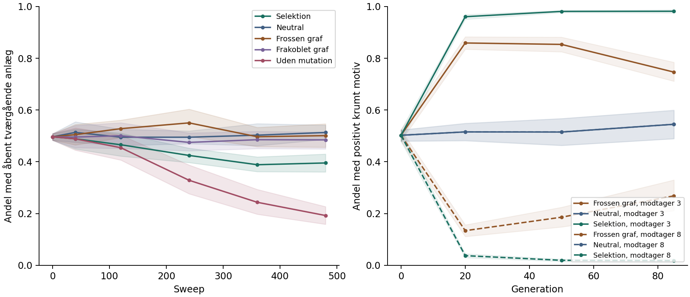

# PUK-forundersøgelse · Evolution og emergent rumtid

*Dansk forskningsrapport, 25. november 2026.*

**Den bedste PUK-kandidat er, efter min vurdering, at undersøge hvornår evolution favoriserer positiv eller negativ grafkurvatur.** Vi har reduceret spørgsmålet til to lokale, arvelige energigrafer med samme grad, samme kantantal og samme energisum. En lineær ligevægtsberegning forudsiger, at det foretrukne fortegn kan vende, når modtageren flyttes. Simulationerne viser netop denne vending, også når energien kun får et endeligt antal lokale afslapningstrin mellem reproduktionsrunder. Det giver et målbart feedback mellem selektion og geometri, et analytisk resultat at efterprøve og en klar usikkerhed at undersøge: Er kurvatur med til at forudsige fitness ud over placeringen af de lokale transportveje?

En lige så enkel alternativ kandidat isolerer dimensionssporet med **ét arveligt bit**. Den viser, hvorfor ressourcegrænser og ikke blot størrelsen af gitteret er afgørende. Ingen af modellerne har påvist emergent Lorentzisk rumtid.

## 1. Hvad skal være sandt, før de fem hypoteser kan testes?

| Hypotese | Matematisk og fysisk minimum | Hvad vi kunne teste |
|---|---|---|
| **H1. Evolution ændrer effektiv geometri.** | Definér en målbar graf og en arvelig variabel, der kan ændre kanterne. Sammenlign ved samme baggrund og med neutral arv eller frakoblet genotype. | I skoven skifter kompatibilitetsgrafen, selv om baggrundens nabograf er fast. I den nye model ændrer ét bit den faktisk åbne transportgraf. |
| **H2. Evolution selekterer krumning.** | Giv konkurrerende genotyper mulighed for arvelig omkobling. Match grad, kantantal og energi. Definér krumningsmål og placér energikilder før fitnesskontrollen. | Skovens standarddata alene identificerede ingen universel slutkrumning. De to nye, gradmatchede moduler kan arve forskelligt fortegn; fortegnet i den foretrukne type afhænger af routingopgaven. |
| **H3. Evolution selekterer effektiv dimension.** | Skeln topologisk, spektral og transportmålt dimension. Sondér flere rum- og tidsskalaer og test et kendt fraktalt eksempel. Brug en uafhængig retningsmåling, så et fit af \(d_s\) ikke står alene. | 3D-kontrollen viste miljøbetinget retningsselektion. Ét-bit-modellen kan reproducere den med en eksakt måling af transporttensoren. Evidens for en ny heltallig eller fraktal skaleringsdimension mangler stadig. |
| **H4. Evolution frembringer eller forstærker tidens pil.** | Positivt understøttede omvendte overgange, stationær fordeling og adskillelse af selektion, ressourcekontrast og opdateringsprotokol. | En eksakt 16-tilstands model viser tidsasymmetri med arvelig routing og en større asymmetri i en bestemt frakoblet kontrol. Makrotilstandens parstatistik skjuler begge. |
| **H5. Rumlige og tidslige egenskaber kan forenes.** | Definér koordineret tid, uafhængige lokale ure og lokal hyperbolsk signaltransport. Samme metrik skal beskrive flere prober uden separat tilpasning af hver. | Optiske signaltider kan komme fra forskellige længde- og urfelter. Skovens pulje kan endvidere koble fjerne felter på ét sweep. De puljefri varianter bevarer lokal energitransport, men de har hverken uafhængige ure eller et Lorentzisk signal. |

En graf kan have lav transportdimension og alligevel ligge i et plant rum. Tilsvarende kan en ændret lokal relaxationsrate være fysisk interessant uden at være relativistisk tidsdilatation. Vi måler egenskaberne separat. [Gross & Blasius, adaptive netværk](https://doi.org/10.1098/rsif.2007.1229) · [Ollivier, grafkurvatur](https://doi.org/10.1016/j.jfa.2008.11.001)

## 2. Nye numeriske fund

### Ét bit er nok til at ændre tværgående transport

Vi fjernede højder, kamp, artsparametre, global pulje og den oprindelige 3D-variants syv transportgenotyper. Tilbage står to lokale energibeholdninger, to naboakser og ét arveligt bit. Transport langs y er tilgængelig for alle. Transport langs x kræver samtykke fra begge ender af kanten. Hver celle modtager samme totalenergi ved start. Hotte og kolde områder adskiller sig kun ved, hvor hurtigt det lokale lager kan gøres disponibel. Naturlig selektion sker gennem lokal kopiering med reservebaseret fitness og mutation.

På 24×24 ved sweep 480 havde **39,6 %** det tværgående anlæg ved selektion, mod **51,3 %** ved neutral arv. Den parrede forskel var **−11,8 procentpoint** [−16,9; −7,2]. Ved frakoblet genotype var andelen **48,5 %**, og ved frossen transportgraf **50,1 %**. Uden mutation faldt den til **19,3 %**. Den sidste kontrol bevarer selektion på startvariationen. Åbne rande svækkede effekten, og en ressourcegradient langs de allerede åbne kanaler gav en svagere effekt end en gradient på tværs.

Ved frossen slutgraf målte vi også homogeniseret transport **i stedet for blot at tælle åbne kanter**. Den normaliserede tværgående diffusivitet på 24×24 var **0,033** med selektion, **0,141** ved neutral arv og **0,093** med frossen startgraf. Den langsgående værdi er eksakt 1 i denne reducerede model. Størrelsen af anisotropien afhænger af gitterstørrelsen. På 40×40 var de tilsvarende værdier **0,082**, **0,145** og **0,094**. Vi kan derfor vise selekteret anisotropi uden at konkludere, at modellen bliver nøjagtigt endimensional.

Forskellen mellem selektion og neutral arv med **én** varm zone var −18,8 procentpoint ved 12×12 og −3,9 ved 48×48. Med et fast mønster på 12 gitterpladser, gentaget på tværs af systemet, var forskellen **−23,6 procentpoint [−26,8; −20,4] ved 48×48**. De to miljøer er identiske ved 12×12. Ved større gitter bevarer det gentagne miljø flere ressourcegrænser pr. areal. Det gør grænsetæthed til en bedre forklaringskandidat end en størrelsesuafhængig gevinst ved lav dimension. Vi har endnu ikke målt en asymptotisk grænselov. På ét dynamisk tidspunkt kan penetration fra en grænse desuden afhænge af den valgte simulationstid.

### Energitæthedseffekten kollapser til en dimensionsløs parameter

Ved fast fitnessfølsomhed \(\beta=14\) faldt andelen med tværgående anlæg fra **49,6 %** til **30,4 %**, da den lokale startenergi steg fra 0,5 til 8. Det kunne ligne en særskilt energitæthedsafhængig geometri. Den lineære energilov forudsiger imidlertid, at det kun er produktet \(\beta T\), der betyder noget for genotypehistorikken. Når \(\beta\) reskaleres omvendt ved hver ændring i den lokale startenergi \(T\), gav fælles tilfældige tal identiske genotypeandele for alle kontrollerede sweeps. Denne simple identitet forklarer den tilsyneladende tæthedseffekt i modellen og foreslår, hvordan man kan lede efter et ægte brud med en ikke-lineær eller absolut energiskala.

### Begge fortegn kan selekteres, når transportopgaven ændres

Hvert modul har 16 celler, tre indre naboer per celle og fast energisum. To arvelige grafer har middelkurvatur **+1/6** og **−1/12**. Der findes en reservekanal via den arvelige graf og et særskilt lokalreservoir via en fælles, fast ring. Et reproduktionsforsøg afhænger af tilgængelig reserve ved en bestemt modtager. Donor og modtager er ydre, lokale roller. Hverken kopiering eller mutation anvender kurvatur.

Vi beregnede den stationære reserve for alle 240 ordnede donor/modtager-par. Med donor 0 havde det positive motiv reserve **0,575** mod **0,448** ved modtager 3. Ved modtager 8 vandt det negative motiv **0,581 mod 0,456**. Det er to kontrasteksempler valgt fra den analytiske screening. Derefter efterprøvede vi selektionsfortegnet i nye populationskørsler.

Ved 12 lokale energitrin pr. reproduktionsrunde og 20 seeds endte det positive motiv på **98,1 %** ved modtager 3 og **1,8 %** ved modtager 8. Neutral og frakoblet kontrol gav **54,5 %** i begge miljøer. Frossen graf gav en vis sammenhæng mellem rumligt miljø og slægt, men svagere end med nedarvet omkobling. Den lokale, finite integrator og fuld forudberegnet ligevægt gav samme vinderfortegn. Fødsler ændrer transportmasken, mens energien bliver i de lokale beholdninger. Den største målte absolutte afvigelse i energiregnskabet i de reducerede populationsforsøg var under \(10^{-12}\). Resultatet viser evolutionær selektion af en arvelig kurvaturskiftende topologi. Testen afgør endnu ikke, om kurvaturen selv har prognosekraft, når transportvejen fra donor til modtager er matchet.

### Den observerede pil kan forsvinde præcist

Lad fire moduler konkurrere på en ring, én genotypeændring ad gangen. Det giver 16 tilstande. Mutation med positiv rate gør den stationære fordeling entydig og den omvendte dynamik veldefineret. Ved skiftende modtagerposition og mutationsrate 0,01 blev fuld, stationær sti-KL **\(2,88\times10^{-5}\)** nat pr. observeret springmulighed. Den neutrale kontrol var nul til afrundingspræcision. Med den valgte rumlige fitnessforskel og frakoblet genotypisk geometri blev den i stedet **\(3,38\times10^{-3}\)**. I dette layout reducerede den arvelige feedback den målte asymmetri sammenlignet med den frakoblede kontrol.

Hvis man kun registrerer antallet af moduler af én type, er KL for ord af længde to **præcis nul**. Det følger af stationær strømbalance over hvert snit mellem to nabotal. Med arvelig routing er længde-fem-divergensen positiv, omtrent **\(6,0\times10^{-10}\)** nat pr. ord i den viste betingelse. Dette er eksakt optælling af ord via den lille overgangsmatrix, og størrelsesordenen forklarer, hvorfor korte simulationer alene kan vildlede. [Roldán & Parrondo](https://doi.org/10.1103/PhysRevE.85.031129)

## 3. Fire realistiske PUK-kandidater

### 1. Hvornår forudsiger grafkurvatur evolutionær fitness?

**Spørgsmål og motivation.** Kan et lokalt kurvaturmål forudsige hvilken arvelig energigraf der vinder, når grad og omkostning er ens? Det binder H2 direkte til observerbar selektion med en model, hvor hele energitransporten kan løses med en lille matrix. Det kendte udgangspunkt er evolution på grafer og Olliviers transportkurvatur. Det interessante i pilotmodellen er, at **den samme gradmatchede graf kan vinde eller tabe ved kun at ændre modtager**. [Lieberman, Hauert & Nowak](https://doi.org/10.1038/nature03204) · [Ollivier](https://doi.org/10.1016/j.jfa.2008.11.001)

**Matematik og selvstændig efterprøvning.** Lær diskrete Laplacianer, bevaret masse i en lineær ODE, stationær nulvektor og et lille optimalt transportproblem. Udled kolonnebalancen, beregn de to ligevægte for donor 0, og genskab reverseringen mellem modtager 3 og 8 uden populationskode. Prøv dernæst nogle få nye, gradmatchede grafer, og sammenlign kurvatur med en simpel blok-Laplacian-respons eller donor/modtager-afstand ved holdout over placeringer. Dette kan afgøre, om kurvatur tilfører noget ud over lokal routing.

**Omfang.** Hold fast i 16 noder per modul, to eller tre graffamilier og én mutationsmekanisme. Ét hovedresultat kan være en lille, falsificerbar prædiktion af fitness på nye placeringer. Projektet kræver ingen Lorentzisk teori.

### 2. Hvorfor bliver transport i et lagdelt miljø næsten endimensional?

**Spørgsmål og motivation.** Hvilken skala bestemmer udviklingen af transversal transport? Piloten giver retningsselektion, transportanisotropi og et tydeligt skift mellem ét og flere ressourcelag. Kendt homogenisering beskriver en frossen ledningsgraf. Det åbne bidrag er at udlede eller måle, hvordan **selve grafen** ændres af selektion og grænsegeometri. [Kipnis & Varadhan](https://doi.org/10.1007/BF00318348) · [Gross & Blasius](https://doi.org/10.1098/rsif.2007.1229)

**Matematik og selvstændig efterprøvning.** Start med den harmoniske middelværdi for to pladser og udled \(\beta T\)-invariansen. Implementér derefter kun de to energideltrin og den lokale kopiering. Udled korrektorligningen eller sammenlign med en random walk i et lille, gentaget felt. Prøv en på forhånd valgt kontrast mellem fast antal grænser og fast grænsetæthed ved flere tider. Et negativt resultat om en universel skalalov er også et testbart PUK-resultat.

**Omfang.** Ét bit, ét 2D-gitter og et lille sæt randbetingelser. Hovedmålet kan være \(D_x/D_y\), sådan at du kan undgå at fortolke en usikker fraktaltilpasning.

### 3. Kan irreversibel evolution være usynlig i den observerede geometri?

**Spørgsmål og motivation.** Hvor meget af tidspilen overlever, når hele det arvelige netværk erstattes af ét simpelt makromål? Det kendte er, at grovkornning kan skjule sti-asymmetri. Den særlige, testbare pointe i piloten er den **eksakte nulregel for par** og en ikke-nul værdi, når positionsinformation bevares. [Roldán & Parrondo](https://doi.org/10.1103/PhysRevE.85.031129)

**Matematik og selvstændig efterprøvning.** Lær endelige Markov-kæder, detaljeret balance, Kolmogorovs cykelkriterium og relativ entropi. Bevis snitargumentet for et observeret optællingstal, og udled én ikke-reversibel mikroskopisk cyklus ved at multiplicere dens fire rater. Find derpå det korteste ikke-reversible observerbare ord for nogle symmetriske og asymmetriske layouts.

**Omfang.** 16 tilstande, én mutationsrate som hovedresultat og en kort variationsanalyse. Det er den tryggeste teoretiske kandidat og kan gennemføres uden en lang populationssimulator.

### 4. Kan en fælles optisk metrik udledes fra energi, geometri og lokale ure?

**Spørgsmål og motivation.** Kan to uafhængige prober bestemme samme lokale lapse og samme signalhastighed på en evolveret graf? Det kendte i analog gravitation er, hvordan en hyperbolsk bølgeligning kan give en effektiv metrik. Vores pilot viser på skovdata, at ren signaltid efterlader en konform tvetydighed. Det nye ville være at teste om en fælles metrik overhovedet kan forklare **observationer af to ure og en lokalt udviklet bølge i den samme reducerede, evolverede model**. [Unruh](https://doi.org/10.1103/PhysRevLett.46.1351)

**Matematik og selvstændig efterprøvning.** Lær bølgeligningen, finite-volume-diskretisering, optisk metrik og simpel identifikation af parametre. Udled tvetydigheden fra \(\ell/N\), og vis hvordan en kendt dynamisk klokkestandard kan bryde den. Tilpas på én probe og forudsig en anden. Brug et statisk 1D-udsnit og sammenlign med frosset og rumligt ommærket geometri. En fælles metrik skal bedømmes ud fra holdout-forudsigelsen.

**Omfang.** Højere risiko. Afgræns til en matematisk identifikationsundersøgelse og ét gitterforsøg. Selve fremkomsten af en relativistisk rumtid er et langsigtet forskningsmål.

## 4. Et arbejdsforløb på 7,5 ECTS

SCIENCE angiver 7,5 ECTS PUK som omkring **206 timers arbejdsbelastning** og projekter under 15 ECTS som arbejde i én blok. Fysiks studieordningsside peger på den gældende uddannelsesspecifikke ordning. Tallene herunder er et forslag til faglig afgrænsning inden for den ramme. [SCIENCE, bilag 5 om PUK](https://science.ku.dk/studerende/studieordninger/faelles_sto/faelles-del.pdf) · [KU, studieordninger for fysik](https://www.ku.dk/uddannelse/studieordninger/fysik)

| Arbejde | Vejledende timer |
|---|---:|
| Litteratur og præcis formulering af én hypotese | 30 |
| Egen udledning og løsning af en analytisk kontrol | 48 |
| Lille egen implementation og uafhængig reproduktion | 54 |
| Falsifikationsforsøg, usikkerhed og analyse | 38 |
| Rapport og faglig gennemgang | 36 |

Vælg ét af de fire forløb. I første forsøg bør du kunne forklare to ligninger og genskabe ét tal fra en tom Python-fil. Gem derefter et nyt, forhåndsvalgt testproblem, så du kan opdage, hvis pilotens interessante fund kun skyldes de første parametervalg.

## 5. Hvad står tilbage?

**H1 og et betinget H3 har bedst støtte direkte i skov- og lokalmodellerne.** **H2 har fået en konkret positiv variant og et vigtigt negativt resultat:** arvelige grafer med begge fortegn kan selekteres, og frosne, tydeligt forskellige substrater konvergerede ikke universelt. **H4 kan isoleres og løses eksakt i en meget lille variant**, men fortegnet på effekten af den arvelige feedback er miljøafhængigt. **H5 har en matematisk falsifikationsregel, men endnu ingen påvist emergent fælles metrik.** Alle fem ligger fortsat i forskningslogbogen. Tillægget er en forundersøgelse med konkrete resultater at efterprøve, herunder negative resultater og de mekanismer der allerede er indbygget.
