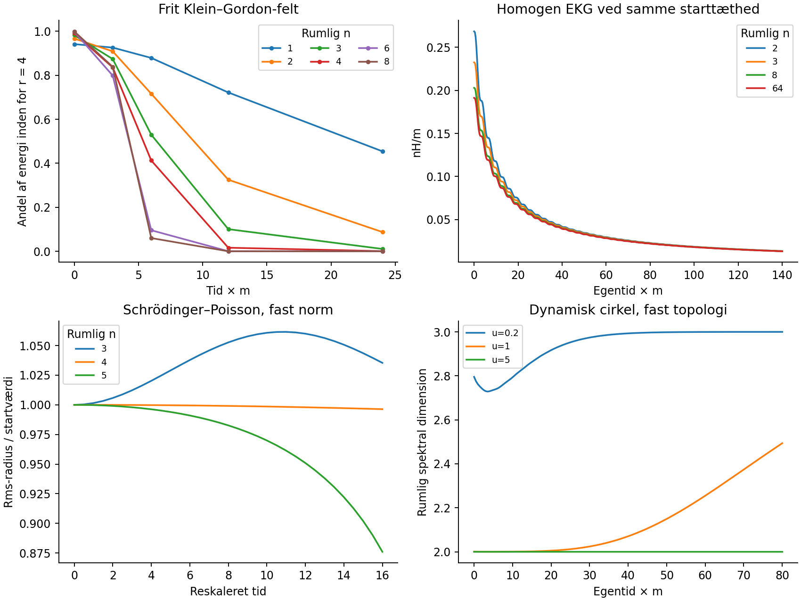

# Evolutionær rumtid V2 · Kritiske dimensioner for et harmonisk felt

*Forskningsrapport, 26. november 2026.*

**Det klareste fund er, at fire og seks rumlige dimensioner markerer forskellige grænser for gravitationel binding.** Ved fire bliver bredden marginal i den ledende Schrödinger–Poisson-approksimation. Ved seks forsvinder den almindelige eksponentielt lokaliserede familie med negativt kemisk potentiale, mens en præcis algebraisk tærskelprofil stadig findes. Det første resultat handler om respons på ændret størrelse. Det andet handler om, hvilke stationære løsninger der kan eksistere. Begge følger af ligningernes skalering, uden at modellen belønner en bestemt dimension.

Det gennemførte arbejde bruger [den fastlåste V2-virkning](../GRUNDMODEL_V2.md). Hver kørsel holder sit kosmologiske eller feltteoretiske rumtidsantal fast. Rapporten skelner mellem eksakte reduktioner af Einstein–Klein–Gordon, kontrollerede approksimationer og effektive mål på et foreskrevet substrat. De tidligere evolutionære forsøg med en reproduktionsregel er referencer fra V1/PUK-sporet og bruges ikke som bevis for V2.

## 1. Fire faktiske numeriske tests

### A. Frit harmonisk felt i fast Minkowski-rumtid

Vi udviklede en radial Gaussisk feltprofil fra hvile via den eksakte Fourier-fase \(\omega(k)=\sqrt{1+k^2}\). Den nominelle startradius for feltprofilen holdes ved at skalere koordinatbredden som \(1/\sqrt n\). Feltets energi indeholder også gradientenergi, så den målte initiale energiradius er ikke identisk på tværs af dimensioner. Direkte energiprofiler er kontrolleret med to radiale kvadraturer i \(n=1,2,3,4,6,8\). Uafhængige Fourier-baserede andetmomenter strækker sig til \(n=64\) og tre bredder.

Ved \(mt=12\) var andelen af energi indeni \(mr=4\) **72,2 % i 1D, 32,5 % i 2D, 10,1 % i 3D og 1,63 % i 4D**. Tallene er for specifik forberedelse og et fast målevindue. De er ikke en universel levetidslov. I den lineære teori har planbølgedispersionen ingen diskret lokaliseret mode under de valgte flade, uendelige randbetingelser. Et periodisk, lokaliseret felt med endelig energi ville kræve Fourier-støtte på frekvensskaller af mål nul. Spredningen er reversibel, og energiprofilerne ved \(t=\pm12\) er identiske i denne tids-symmetriske forberedelse. Radial Shannon-entropi er et mål for energiens fordeling i et radialt mål, ikke termodynamisk entropi eller stientropiproduktion.

### B. Fuld Einstein–Klein–Gordon i den homogene sektor

Vi integrerede feltligningen og Raychaudhuri-ligningen med lapse 1 i flade og krumme FLRW-baggrunde ved \(n=2,3,4,5,8,16,32,64\), to faser og to normaliseringer. En lukket ekspanderende gren blev stoppet ved \(H=0\). For flade og åbne grene sammenlignede vi med en separat formulering, hvor \(H\) løses algebraisk fra constrainten. Den største relative Hamilton-residual med fin tolerance var **\(7,83\times10^{-10}\)**. Ved løsere tolerance var den **\(1,30\times10^{-7}\)**. Momentum-constrainten følger af symmetrien, som også udelukker lokal partikel- eller klumpdannelse. Se [udledningerne](MATEMATIK.md).

Ved samme koblede begyndelsestæthed \(\chi=0,018\) faldt \(nH/m\) fra **0,2683** i to dimensioner til **0,1912** ved 64. Den særskilt integrerede \(n\to\infty\)-grænse startede ved **0,1897**. Den enkelte retnings Hubble-rate falder her som \(1/n\), mens feltets samlede dæmpning ikke gør. Ved fast \(H/m\) sammenligner vi en anden koblet starttæthed og finder ingen tilsvarende dæmpningslov. I det hurtigt oscillerende regime nærmer volumenfortyndingen sig støvmodellen. \(\rho a^n\) kan variere i de fulde løsninger, fordi feltet udøver trykarbejde.

\(n=1\) kommer ikke med i den gravitative integration. Einstein-tensoren er identisk nul i 1+1 under den fastholdte virkning. \(n=2\) har fulde materieligninger, men ingen almindelig Newton-tiltrækning fra en langsom, trykløs kilde ved den svage ledende orden. Det er grunden til, at Schrödinger–Poisson-forsøget starter ved tre. [Turner](https://doi.org/10.1103/PhysRevD.28.1243)

### C. Kriterier for svag gravitationel binding

Vi løste det radiale stationære Schrödinger–Poisson-problem ved \(n=3,4,5\), central amplitude 1, to ydre afstande og to BVP-tolerancer. Det kemiske potentiale var omtrent **−0,6922, −0,1996 og −0,05044** i de valgte reskalerede enheder. De tal normaliserer profilernes centrum, ikke fysisk ADM-masse eller lige kompakthed på tværs af dimensioner. Normer og tolerancer er i data. Den største relative virialrest på den fine løsertolerance var under \(1,4\times10^{-6}\).

Vi udviklede dernæst profilerne direkte, uden fast breddeansats, med radial finite volume, symmetrisk splitting, Poisson-match mod ydre vakuum og en normbevarende Crank–Nicolson-del. Både amplituden og bredden blev ændret i hver sin test. Når bredden først forkortes 3 % ved fast norm, giver den fine kørsel efter tiden 16 disse rms-radier i enheder af den umiddelbare start:

| Rumlig n | Bredde divideret med startbredde | Fortolkning |
|---:|---:|---|
| 3 | **1,0354** | Genoprettende respons på det afprøvede tidsinterval |
| 4 | **0,9963** | Nær den eksakt marginale skalafamilie. Restdriften kan vurderes med gitterforfinelse |
| 5 | **0,8760** | Sammentrækningen forstærkes i svagfeltsdynamikken |

En breddeøgning gav modsat respons i tre og fem dimensioner. Normafvigelsen var af størrelsesorden \(10^{-13}\), og største målte energiændring per norm faldt fra ca. \(1,2\times10^{-5}\) til \(2,0\times10^{-6}\) under gitterforfinelse. Større boks, finere trin og ydre norm er gemt. Tallene beviser hverken fuld relativistisk stabilitet eller kollaps til et sort hul.

De analytiske identiteter er stærkere end et fit. Fast-norm skalering giver \(E''(1)=2(4-n)T\), mens \(\mu M=(n-6)T/(n-2)\) for en stationær løsning. Ved \(n=6\) findes den eksakte profil \(f=12\sqrt2/(1+r^2)^2\) med \(\mu=0\). Vi integrerede dens norm, kinetiske og gravitationelle energi separat og kontrollerede begge identiteter med relativ fejl under \(10^{-11}\). Normen er endelig, mens rms-radius er divergent på grund af den algebraiske hale. Det er en nyttig negationskontrol for en påstand om, at *al* binding forsvinder allerede ved fire, eller at *ingen* stationær tærskelprofil er mulig ved seks.

En enklere Gaussisk breddeansats visualiserer samme skalafortegn til \(n=128\). Den er en variational legetøjsmodel. Høj-n-grænselaget \(R=1+x/n\) er resultat af kraftloven. Kørsel tæt på den numeriske sammentrækningsgrænse blev stoppet, og der er ingen relativistisk konklusion ved lille bredde. Eksistens af langlivede oscillatoner og gravitationel afkøling i relevante EKG-regimer er kendt. Svagfeltstesten må ikke forveksles med en ny inhomogen oscillatonberegning eller reproduktion. [Seidel & Suen, oscillatoner](https://doi.org/10.1103/PhysRevLett.66.1659) · [Gravitationel afkøling](https://doi.org/10.1103/PhysRevLett.72.2516) · [Fodor m.fl., vilkårlig dimension](https://doi.org/10.1103/PhysRevD.81.064029)

### D. En effektiv dimension ændres, selv om den fundamentale holdes fast

I en eksakt homogen Bianchi-I-reduktion valgte vi en på forhånd kompakt retning. Med en begyndende kontraktion gik en cirkel fra radius **0,300** ned til **0,287** og derefter op til **0,562**. For den samme varmeskala \(u=1\) ændrede den målte rumlige spektrale dimension sig fra **2,001 til 2,494**. Andre probeskalaer ser andre værdier på den samme rumlige skive. I forsøgsfamilien fandt vi ingen stabiliseret radius. En homogen skalars spænding er lokalt isotrop, så en vedvarende relativ stabilisering kræver en yderligere mekanisme.

## 2. Dynamisk dimension uden et forudvalgt optimum

| Forslag | Hvad det faktisk ændrer | Hvad en fysisk test skal kontrollere |
|---|---|---|
| **Dynamisk kompakt cirkel** | En skala og Kaluza–Klein-gabet \(j/R\). Dette er gennemført ovenfor. | Fast topologi, men ændret spektral dimension. Vis med uafhængige signalprober, hvis man vil gøre målet operationelt. |
| **Hierarkiet x, xy, xyz, xyzw** | Forskellige aktive interaktionsretninger i et fælles ambient gitter. En fælles akse kan bære en symmetrisk kantflux, fx via et feltled \(C_{ij}(\phi_i-\phi_j)^2/2\). | Symmetrisk kobling og fælles tidsudvikling. Hvis \(C_{ij}\) udvikler sig, skal dens energi med i Hamiltonfunktionen. At deaktivere en retning giver ikke uden videre en regulær Lorentz-metrik med lavere dimension. |
| **Regge eller diskret geometri** | Ved fast simpelksdimension varierer man kantlængder. Krumningsleddet bygges af deficits og \((D-2)\)-hænger. | Triangulationsændring kan ændre konnektivitet, men sædvanlig Regge ændrer ikke automatisk \(D\). Et forslag med blandet dimension skal angive overgangsflade, matching, variation og en fælles constraintstruktur. [Regge](https://doi.org/10.1007/BF02794923) |
| **Kvantemekanisk inspirerede dimensionstilstande** | Kvantetilstande kan formelt ligge i en direkte sum \(\bigoplus_D\mathcal H_D\) med blokke for hver fast dimension og eksplicitte off-diagonale overgange. | Uden overgangsoperator er \(D\) bevaret. Med overgange kræves en fælles norm, dynamik og energi samt klart specificerede matrixelementer. Selv-adjungerede overgangsblokke sikrer kun unitær evolution under passende domæneantagelser. De forklarer ikke i sig selv dimensionens værdi. |

Et dimensionsneutralt forslag skal også bestemme målet over geometrier og de dimensionfulde koblinger indbyrdes. At tælle lige mange tilstande i hver sektor er ikke i sig selv et fysisk neutralt mål. Vi indførte ingen dimensionsenergi eller regel, der favoriserer \(n=3\).

## 3. Evolution uden en fitnessfunktion

På fast Minkowski-baggrund er modellen lineær. To energipakker kan interferere, men deres feltudvikling følger superposition. En pakke kan derfor ikke give en ny, permanent koblingsregel videre gennem reproduktion i den frie reference. I fuld EKG bryder det dynamiske tyngdefelt superposition. Gravitationel afkøling kan omorganisere energi, og oscillatoner er kandidater til energibærende objekter. De er begyndelsen på et spørgsmål om vækst, kollision og stabilitet. Intet af dette demonstrerer en cyklus af forælder → flere levedygtige efterkommere med persistent arvelig variation.

En næste, særskilt variant kan teste to målbare krav: **gentagen deling med nettoafkom efter en energipuls** og **forælder–afkom-sammenhæng i en geometrisk egenskab efter kontrollen for samlet energi**. Test først kollisioner og indfaldende energipakker i inhomogen harmonisk EKG. Hvis forskellige klumper er utilstrækkeligt adskilte eller robuste, kan en eksplicit ekstra feltkanal eller en kontrolleret ikke-lineær interaktion prøves i særskilte handlinger. Kilder, vækst og eventuel stråling skal bogføres i den totale stress-tensor. Ingen af disse forslag kræver, at man indfører en fitnessfunktion. De lover heller ikke reproduktion.

- **H1–H2:** Felt og krumning påvirker hinanden i EKG-reduktionerne. Målene her indeholder ingen reproduktiv selektion, så feedbacken er fysisk og endnu ikke evolutionær.
- **H3:** 4 og 6 er kritiske dimensioner for forskellige bindingsegenskaber. Effektiv dimension kan ændres ved kompakt geometri. En foretrukken fundamental dimension eller selektion af dimension er fortsat åben.
- **H4:** Udvidet eller lokaliseret energi kan ændre et grovkornet entropimål. Den frie kontrol er reversibel. Homogene ekspansionsbetingelser tilføjer en tidsretning ved tilstandens forberedelse. Ingen stationær, evolutionær sti-KL er målelig i de viste V2-forløb.
- **H5:** Egentid og signalfront kommer fra samme EKG-metrik. Det efterprøver en egenskab ved den foreskrevne teori. Ingen emergent, selekteret metrik er demonstreret.

## 4. Det bedste afgrænsede PUK

**Udled de to kritiske dimensioner for gravitationelt bundne skalarkonfigurationer, og efterprøv dem i det radiale svagfelt.** Et første selvstændigt resultat er at udlede \(E(R)\), \(E''(1)\) og \(\mu M\) med blyant og papir. Verificér derefter den eksplicitte \(n=6\)-profil i Python og beregn norm og energi med en uafhængig kvadratur. Gå videre til ét fast-norm breddeforsøg ved \(n=3,4,5\), og mål, om fysisk og numerisk drift kan skilles ad med gittertrin og bokse. Det kræver kun radialligninger, variation og lineær algebra, mens det fysiske spørgsmål kommer direkte fra Einstein–Klein–Gordon.

Et alternativt, enklere PUK er **dynamisk kompaktifikation uden ændret fundamental dimension**. Udled shear-bevarelsen, beregn den cirkulære varmekerne, og skeln prober med fast fysisk opløsning fra prober, hvis opløsning følger \(R(t)\). Find derefter en falsificerbar dynamisk betingelse for stabilisering af radius. Ingen af de afgrænsede forløb kræver, at variabel fundamental dimension eller reproduktion først er løst.
