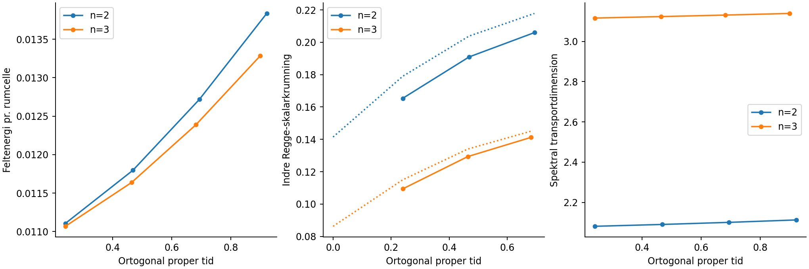

# Skovlaboratoriet V3 · Regge-kantlængder og et koblet skalarfelt

*Forskningscheckpoint, 26. november 2026.*

**Den verificerede koblede tidsudvikling er periodisk og homogen.** Her kommer ændringer i sidelængde, felt og ortogonal tidsafstand fra én Lorentzisk Regge–skalarvirkning. En generel fast-dimensionel virkningsmotor og en fri kantvariation er implementeret. De afprøvede inhomogene randværdiforsøg opnåede dog ikke stationaritet med de krævede residualer. Den fastlåste V3-idé med blandede lokale topdimensioner har desuden et særskilt, uløst overgangsproblem. Derfor er dette et verificeret V3-checkpoint med en afgrænset dynamisk sektor.

[Udledning af virkning, felt, constraints og overgangsproblemet](MATEMATIK.md) · [Forskningslogbog](LOGBOG.md) · [Interaktivt laboratorium](lab.html) · [Rådata](results/)

## Hvad motoren konstruerer

Aksialkanter genereres fra **reciprok tilladelse til samme akse** på to koordinatnaboer. Kun komplette kuber bliver højere celler. Samme algoritme registrerer egentlige grene med lavere maksimal dimension. I det rene tilfælde trianguleres rumtidskuberne med en fælles staircase-regel. Hver fysisk kant har ét signeret interval, også ved delte simplicer. Geometriske diagonaler har egne intervalfrihedsgrader. Den direkte aksiale feltoperator bruger kun eksisterende ben.

Metrik eller ansats, potentiale og begyndelsesdata kan skiftes. [Regge-motoren](regge.py) beregner virkning og analytiske gradienter ud fra Gram-matricer, Lorentziske vinkler, Schläfli-identiteten og Dirichlet-randled. Den [homogene driver](homogeneous.py) trækker disse gradienter tilbage til frustumform, felt og ortogonal tid. [Slab-solveren](stationary.py) behandler de indre intervaller og feltknuder hver for sig. Dens stationaritetsflag bygger på de uafhængige residualer. Ingen fjedre eller efterfølgende gravitationskorrektion anvendes.

Aksial materie er eksakt for simplexens affine kinetiske term på en ortogonal metrik. Når staircase-basis har metriske krydsled, er den aksiale Hodge-form en tilnærmelse. Den fulde affine variant er med som en særskilt kontrol og kan give nodale diagonalkoblinger. Det er en konkret forskel mellem den fastlåste transportregel og fuld fri Einstein–skalargeometri. Piloterne dokumenterer den ortogonale kontinuumsgrænse i en homogen sektor. Vilkårlige skæve, inhomogene løsningsgrene er åbne.

## Testresultater

| Forsøg | Resultat |
|---|---|
| **Minkowski og nul felt, \(n=1,2,3,4\)** | Største indre defekt **\(1,6\times10^{-15}\)**. Frie kantresidualer under \(4\times10^{-15}\). Simplexvolumenerne gav boksens kendte rumtidsvolumen. |
| **Virkningens første variation** | Uafhængige centrale differenser matchede kant- og feltgradienternes retningsafledte med største forskel **\(5,9\times10^{-10}\)** for de testede trin. Begge stofstencils, ikke-nul masse, kvartisk led og \(\Lambda\) indgik. |
| **Krumning uden koordinattrick** | Fem flade sektorer om ét timeligt hinge gav en defekt på **\(\pi/3\)**, som beregnet direkte fra keglegeometrien. Den er flad væk fra det singularitetsbærende hinge. En forskudt konstant Minkowski-metrik gav igen nul indre defekt. |
| **Fast geometri og skalar** | En affin, masseløs feltløsning med ændret indre startgæt blev genfundet. En aksial impuls på forskudt Minkowski gav ingen afledt feltkobling på diagonaler. På regelmæssigt gitter nærmede dispersionsloven sig Minkowski-KG ved forfinelse, og den reversible stencil bevarede sin kvadratiske skyggeenergi. |
| **Periodiske, homogene Regge-frusta** | De accepterede plader løste variational felt-, skala- og lapse-ligning i \(n=2,3\). Testede harmonisk, masseløst og kvartisk felt, forskellige feltimpulser og koblinger, samt begyndelsespladen for vakuum med \(\Lambda\). Loggen registrerer plader, som solverens næste trin måtte afvise. |
| **Fri kantvariation i en endelig boks** | De fire afprøvede randværdiforsøg havde slutresidualer fra **\(1,35\times10^{-5}\)** til **\(7,08\times10^{-5}\)**, inklusive timelige kantresidualer. De er alle over \(10^{-8}\)-kriteriet. Et optimeringsstop tæller derfor ikke som en accepteret løsning. |

Den løste homogene gren fra \(a=1,\phi=0,22,\dot\phi=0,08\) udviklede både \(a\) og feltet. Ændring af gravitationskoblingen ændrede løsningen. Med længere tidssteg blev forløbet med fri lapse i begge dimensioner fulgt til omtrent ortogonal tid 0,9. De fineste forsøg med fri lapse og den valgte gren stoppede tidligere. Deres rådata gemmer første afviste residual. Vakuum-\(\Lambda\)-kontrollen accepterede kun første plade i hver af de to opløsninger. Den fulde Minkowski-vakuumtest er separat. Som en ekstra kontrol varierede vi de individuelle kanter i to allerede accepterede homogene plader. På den grove 3+1-prøve var største timelige kantrest \(6,12\times10^{-6}\), selv om den fælles lapse-variation bestod. Kollektiv stationaritet attesterer således ikke de uafhængige ligninger.

### Raffinement mod kontinuum

Vi halverede både den nominelle rumlige sidelængde og tidssteget ved fast fysisk initialt felt og dimensionsløs sammenligning \(a/\ell_0\). En særskilt kontrol holder ortogonal tidsafstand fast, løser kun de to indre Euler–Lagrange-ligninger og måler lapse-rest uden at projicere den bort. Kontrollen tester kontinuumsgrænsen og registrerer, hvor meget den fikserede tid bryder den diskrete constraint. Ved fælles sluttid 0,96:

| Rumlig n | Aksial fejl i \(a/\ell_0\), groft → fint | Aksial fejl i \(\phi\), groft → fint | Største volumen-normaliserede lapse-rest, groft → fint |
|---:|---:|---:|---:|
| 2 | 0,00298 → 0,0000473 | 0,000613 → 0,00000978 | \(6,61\times10^{-6}\to1,61\times10^{-7}\) |
| 3 | 0,000636 → 0,00000972 | 0,000294 → 0,00000464 | \(9,93\times10^{-6}\to2,24\times10^{-7}\) |

Tids- og rumtrin blev begge reduceret med faktor otte. Fejl i skala og felt faldt omtrent som anden orden. Den affine kontrol viste samme orden med mindre feltfejl. Det er en stærkere konvergenstest end at sammenligne forskellige sluttider, men den attesterer ikke en eksakt løst lapse på de fikserede forløb.

## De tre hovedmål og deres begrænsninger

**Energi per rumcelle** estimeres fra feltets ortogonale tidsforskel, potentialet og den tilhørende rumlige volumen. Det er et lokalt stoffeltmål; tyngdearbejde og ændret volumen kan ændre det. En generel bevaret GR-boksenergi rapporteres ikke. Den stationære, flade bølgestencils bevarede skyggeenergi måles særskilt.

**Skalarkrumning** estimeres fra Regge-summen ved en indre tidsskive. To grænsevinkler sys til én fælles rumlig defekt, og halvdelene af de tilstødende pladers bulkbidrag vægtes med deres volumener. Det er et grovkornet mål; den analytiske FLRW-kurve vises ved samme indre tid. Fx gav den masseløse 2+1-kontrol **−0,02718** mod **−0,02703** på første indre skive i den grovere serie. Der indføres ingen regel, hvor større dimension giver større krumning.

**Effektiv dimensionalitet** måles ved varmesporet af den rumlige Laplacian for en periodisk forlængelse af de homogene kuber. 16, 32 og 64 punkter per akse er et separat finite-size-valg. Denne prøve måler den faste topologis transport ved endelig opløsning og viser små skalaafvigelser fra n. Det er ikke bevis for ny topdimension. Homogen energifordeling giver Shannon-entropi \(\ln(3^n)\) når der er feltenergi. Vakuum har ingen normaliseret energifordeling. Strut-egentid, ortogonal tid og bølgens dispersionsskala registreres som tre særskilte tidsmål.

## De fem hypoteser

- **H1 og H2.** Stof og metrik har gensidig variational feedback i den accepterede sektor. Vi tester hverken evolution eller selektion af krumning her.
- **H3.** Aksialmaske, fundamental topdimension og spektral måling er tre forskellige input eller målinger. Alle kørsler har fast topdimension. Energiforskelle på tværs af n er ikke selektion.
- **H4.** Den reversible stencil og vending af pladevirkningen kontrolleres. En observeret monoton entropi på en ekspanderende baggrund ville ikke være stientropiproduktion. Den størrelse er ikke bestemt her.
- **H5.** Egentid og kausal signatur er operationelle målinger fra de anvendte intervaller. De bruger en foreskrevet Einstein-virkning. Forsøget etablerer ingen emergent rumtidsmetrik.

Næste nødvendige matematiske udvidelse er et veldefineret variationsprincip ved en overgang mellem topdimensioner, inklusive sektormål, randdata og constraint-match. Et separat teknisk spørgsmål er at få alle uafhængige timelige og rumlige kantvariationer i en inhomogen slab til at bestå samtidigt. Begge åbne punkter forbliver synlige i kode, log og rådata.
