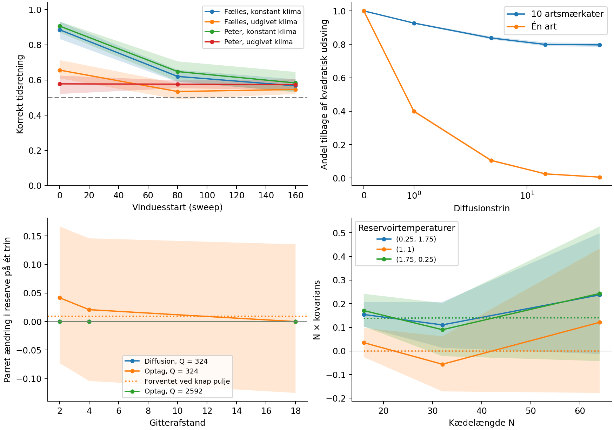
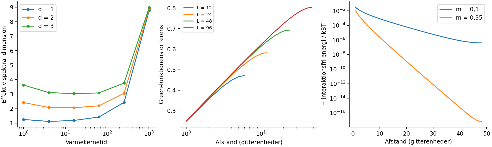
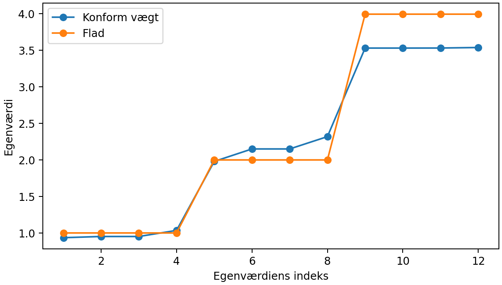

# Hvor kommer tidens pil og fjernvirkningen fra i Skovlaboratoriet?

*Eksplorativ undersøgelse, 25. november 2026.*

Skovlaboratoriet kombinerer lokal diffusion, en fælles energipulje og irreversible opdateringer af træer. De tre mekanismer kan skilles ad. Den lokale diffusion giver et matematisk rent forsøg med en spektralt bestemt relaxation. Den fælles pulje kan give et øjeblikkeligt signal på vilkårlig gitterafstand. En separat benchmark viser, hvordan et lokalt system med temperaturgradient kan danne stationære fjernkorrelationer.

## 1. Hvilken model undersøgte vi?

Grundlaget er `main` ved `cb5877888f5dc8fea06b8224f891a04a4be3302d`. Den fælles udgave ligger i `index.html`, den udgivne Peter-udgave i `peter/index.html`. Den fælles HTML i `william-dev` ved `c1d1386` har samme dynamiske script som `main`. Peter-arbejdsbranchen ved `1466285` indeholder blandt andet CI-forsøgene for Zeta, netværksprognosen og den metrisk vægtede diffusionsprototype. Den har Peter-simulatoren i roden, hvor `main` har fællesudgaven. Begge udgivne HTML-motorer er kørt i forsøget. Ingen produktionsfiler er ændret.

Det øvrige repository indeholder logbøger, Pages- og testinfrastruktur samt særskilte Einstein–Cartan-, FLRW- og kollapsundersøgelser. De har egne ligninger og solvere og kaldes ikke af skovens opdatering. De er kortlagt på dokumentations- og testniveau. En fuld ligningsaudit af de separate laboratorier og alle deres udviklingsbranches ligger uden for den gennemførte pilot. De historiske skovlogbøger dokumenterer desuden tidligere termiske fortolkninger og tidligere Markov-forsøg med tidens pil. De udgivne skovmotorer nedenfor er den afgørende kilde til gældende regler. [Fastlåst kildekode](https://github.com/pdamkier-del/skovlab/tree/cb5877888f5dc8fea06b8224f891a04a4be3302d)

Hver levende plads har art \(a_i\), højde \(h_i\), reserve \(E_i\) og strukturenergi \(U_i\). Peter-versionen gemmer desuden individuel angrebstendens og arvelig spredning. De fire klimafunktioner fastlægger inputloft, vækstpris, spredningspris og vedligeholdelsespris. I Peter-versionen kan inputloftet desuden få en seed-afhængig faktor, som er konstant i hver klimaperiode.

| Trin | Hvad koden gør |
|---|---|
| Optag | Levende felter besøges i tilfældig orden. Hvert modtager op til \(r(t)\) fra den samme pulje \(Q\), så længe der er energi. |
| Diffusion | Samtidig symmetrisk strøm \(\alpha_*(E_i-E_j)\) per kompatibel kant. Peter kræver ens art. Fælles accepterer også forskellige arter med strategiforskel højst \(\Delta s\). |
| Vedligehold og død | Vedligehold flytter reserve til \(Q\). Ved \(E_i\leq M(t,h_i)\) slettes træet og både reserve og struktur går til \(Q\). |
| Vækst og spredning | Vækst omdanner \(E_i\) til \(U_i\) og lægger 1 til højden. Ved spredning til en tom nabo betales gebyr til \(Q\) og den resterende reserve, strukturen og højden deles ligeligt mellem forælder og afkom. |
| Kamp og etablering | Gebyr betales til \(Q\). Angriberen vinder med \(h_i/(h_i+h_j)\). Taberen slettes. Afkom på den erobrede plads etableres, hvis angriberen stadig har råd. Fælles filtrerer uadskillelige angrebsmål. Peters `external` returnerer alle naboer, så også artsfæller kan angribes. |
| Mutation | Afkom kan få en ny artsidentitet. Ved en spontan hændelse kan et træ mutere eller en tom plads etableres med energi fra \(Q\). |

En sweep udfører trinene ovenfor i rækkefølge. Grupper af sammenhængende artsfæller behandles i tilfældig orden. I fællesudgaven og Peters tilstand uden bet-hedging vælges vækst eller angreb på gruppeniveau. Peters bet-hedging giver træerne individuelle valg. En lang koloni kan derfor korrelere fjerne beslutninger via opdateringsreglen. Det er endnu en direkte kobling at kontrollere, når formålet er rent lokal fysik.

### Bevarelse, irreversibilitet og symmetri

Den bevarede størrelse er \(\mathcal E=Q+\sum_i(E_i+U_i)\). Hvert af de viste trin flytter eksisterende energi mellem tre bogførte beholdninger. Initialisering lægger en bestemt mængde i systemet. Afvigelser bagefter kan komme fra flydende tal og tolerancen ved spontan etablering. Højde, antal træer, antal levende arter, sum af reserve alene og sum af struktur alene kan alle ændre sig. Der er ingen dynamisk position eller impuls for et træ.

Mange forskellige lokale tilstande kan give den samme efter død og tilbageførsel. En ordinær negativ vækst er fraværende. Selv en deterministisk, inverterbar diffusionsmatrix har en ustabil invers i den forstand, at den forstærker de rumlige moder, som diffusionen dæmper. Den formelle inverse er ikke en lokal blanding med ikke-negative vægte. Disse mekanismer gør en pil forventelig. Et selvstændigt spørgsmål er, hvor meget af den der kan aflæses efter filtrering i rum og tid.

Flade periodiske gitre har translationer, kvadratsymmetrier og ens koordinatvægte. Fælles kanter uden periodisering bryder translation. De ringbaserede \(k=\pm1\)-indstillinger har varierende grad og ringstørrelse. De tilnærmer en geometrisk idé via konnektivitet, mens cellearealer og metrik mangler i den originale operator. Kantsymmetri sikrer en ensartet reserve ved ligevægt inden for hver komponent. Isotropi i en 2D-kontinuumsgrænse følger fra det lille-bølgetalsled i det flade fire-nabo spektret. Den er tilnærmet ved lange bølgelængder. Graf-isometrier er relevante for overgangsreglen i fordeling. Et konkret seed kan følge andre tilfældige valg efter en ommærkning.

### Diffusion som diskret matematisk laboratorium

Lad \(\mathsf L=D-A\) være Laplacianen for de åbne kanter. Når mærkater og geometri er frosset, er den originale opdatering
\[
E^{t+1}=P E^t,\qquad P=I-\alpha_*\mathsf L,\qquad
\alpha_*=\min(\alpha,0{,}45/d_{\max}).
\]
Matricen er symmetrisk og dobbeltstokastisk. Fordi \(0\leq\lambda(\mathsf L)\leq2d_{\max}\), ligger egenværdier for \(P\) mellem 0,1 og 1. Bevaringen af hver komponents reserve er en præcis konsekvens. En vilkårlig start nærmer sig komponenternes respektive middelværdier. En koncentration kan bestå på en isoleret plads eller som et højere plateau i en afkoblet komponent. En isoleret top på en forbundet aktiv graf diffunderer væk. En perturbation har desuden præcis nul effekt uden for grafafstand \(t\) efter \(t\) diffusionstrin. Ingen af disse sætninger forudsætter, at resten af simulationen er i ligevægt.

Med \(p_i=E_i/\sum_jE_j\) giver Jensens ulighed \(H(Pp)\geq H(p)\) for \(H(p)=-\sum_i p_i\ln p_i\). Samme argument eller spektret viser, at kvadratafvigelsen fra komponentmidler aftager. Artsentropien bruger artshyppigheder og måler noget andet. Hver størrelse kan være informativ, og en fysisk entropi kræver yderligere specifikation af ligevægtsmål, varme og temperatur. Der findes ingen generel monotonicitet for reserve-Shannon-entropien gennem et helt sweep.

## 2. Numerisk design

- **Tidens pil.** 288 forløb, 24 seeds per model, størrelser 12, 24 og 36, med udgivet klima eller konstante koefficienter. Mål middel, varians, nabo-ruhed og Shannon-entropi af reservefeltet med blokke på 1, 3 eller 6 pladser per side. En lineær model trænes på standardiserede forskelle og forsøger at genkende den kronologiske rækkefølge af to billeder. Den ser hverken klokke, klima, seed eller artsmærkater. Der trænes en separat model per vindue. Et lag på 80 matcher udgivet klimafase, men kan krydse et støjskift. Konstant-klima-kørslerne fjerner også støjskiftet.
- **Lokalt impulssvar og blanding.** Brug originalkaldet `diffuseEnergy` alene på tre geometrier og fire størrelser. Kendt positiv impuls, korteste grafafstand og varierende frosne artsmærkater. Faktorforsøg med ingen, én eller begge toppe, fire/otte naboer og tre værdier af \(\alpha\). Formelbaseret torus-spektrum i dimension 1, 2 og 3 er en separat reference.
- **Fjernrespons.** Fjern ét træ før et sweep, mål ændringen i reserve på en anden plads og sammenlign parret med samme seed i et intakt gitter. Gentag for optag alene, diffusion alene og fuld dynamik. Brug både knap og rigelig pulje. Suppler med de numeriske parametre, der undertrykker kamp og vækst.
- **Lokal termisk reference.** I KMP deles et pars energi med en uniform andel \(p\). Ved enderne trækkes en uafhængig eksponentiel reservoirenergi med middel \(T\), blandes og kasseres igen. Hvert sweep er \(N+1\) uafhængige valg af en kant ud af \(N+1\). Mål 48 seeds per forhold ved \(N=16,32,64\). Vent \(40N^2\) sweeps og brug 6.000 målinger med afstand \(N\) sweeps. Analytiske første- og andetmomenter er reference. Den endelige, lukkede momentligning følger af \(\mathbb E[p]=1/2\), \(\mathbb E[p^2]=1/3\) og \(\mathbb E[p(1-p)]=1/6\).
- **Spektral og metrisk reference.** Beregn en frossen torus, en Gaussisk feltmodel og et gitter med statisk konform metrik. Disse beregninger har ingen Monte Carlo-usikkerhed. Sammenlign flere opløsninger og fjern nulmoden, hvor det er matematisk nødvendigt.

Data, figurer og reproduktionskommandoer er forklaret i [README](README.md). Intervallerne er 95 % seed-bootstrap. De viser spredning mellem selvstændige simulationer for en valgt betingelse. De inkluderer usikkerhed fra hverken valg af model eller søgning på tværs af mange indstillinger. Holdout-intervallerne er betinget af de 12 træningsseeds.

## 3. Resultater

### 3.1 Tidens pil er tydelig i opstart og svagere senere

Eksempel fra \(24\times24\) ved konstant klima, kun reservefeltet og blokstørrelse 1. Intervaller er 95 % over 12 holdout-seeds. Tilfældig tidsorden giver 50 % i forventning.

| Vindue og lag i sweeps | Fælles | Peter |
|---|---:|---:|
| 0–80, lag 20 | 88,5 % [83,3–93,2] | 90,6 % [87,5–93,2] |
| 160–320, lag 20 | 56,7 % [53,5–60,2] | 58,3 % [52,8–64,4] |
| 160–320, lag 80 | 78,6 % [69,8–87,3] | 46,4 % [29,4–62,7] |

Med \(6\times6\)-blokke faldt det sene fællessignal ved lag 20 til 50,9 % [47,7–54,2]. Ved lag 80 faldt det til 65,5 % [58,7–72,6]. I Peter-udgaven var det sene 80-lag usikkert ved begge rumlige opløsninger. De tilsvarende fortegnsscramblede lag-20 kontroller lå omtrent ved tilfældighed i det viste sene vindue. Sammenligningerne er eksplorative og viser, hvilke skalaer der er værd at replikere. De tidlige forløb starter med ens reserve for alle levende træer. En del af opstartssignalet kan derfor komme fra dette særlige udgangspunkt. Den sene drift kræver endnu en stationaritetstest.

Reservefeltets Shannon-entropi gik ned i 5.270 af 11.520 fire-sweep-intervaller for konstant klima. Det er direkte modbevis mod en generel monoton vækst af dette mål under den fulde model. Største målte absolutte fejl i den bogførte totalenergi var \(3{,}85\times10^{-8}\) på tværs af det fulde tidsforsøg. Det frosne diffusionsled blev kontrolleret særskilt.

### 3.2 To toppe består superpositionstesten

På frosne grafer fulgte 540 sammenligninger i tre geometrier identiteten
\[
E_{AB}-E_A-E_B+E_0=0
\]
med maksimal punktvis residual \(8{,}9\times10^{-16}\). Maksimal fejl i energisummen i dette forsøg var \(6{,}9\times10^{-12}\). Reservesummen i enkeltpulser var konstant til \(10^{-12}\); ingen puls overskred sin grafafstandskegle. Det flade returforløb matchede Fourierformlen \(N^{-1}\sum_k(1-\alpha_*\lambda_k)^t\) med fejl under \(10^{-12}\). En effektiv tiltrækning, der skulle vise sig som en ændring ud over summen af separate svar, er dermed falsificeret for dette diffusionsled. Resultatet afgrænser de dynamiske maskeskift og de øvrige regler som eventuelle kilder til en ikke-lineær respons.

Med frosne, tilfældigt blandede artsmærkater var 79,7 % [78,6–80,9] af den oprindelige kvadratafvigelse tilbage efter 64 trin på det flade \(36^2\)-gitter. Med én art var det 0,60 % [0,48–0,73]. De to ringgitre viste samme kontrast mellem blandede mærkater og én art. Tallene måler tilbageholdelse af reservevariation, som afbrudte kanter forklarer. De viser ikke en øget bindingskraft mellem energitoppe.

### 3.3 En mekanisme for fjernrespons er allerede indbygget

Når puljen er knap og alle \(N\) træer kan optage, får en given probe i forventning \(Q/N\), uanset dens beliggenhed. Fjernes et træ med \(S=E_i+U_i\) inden optag, er forskellen i forventning
\[
\Delta E=\frac{Q+S}{N-1}-\frac{Q}{N}.
\]
Formlen gælder, når begge puljer er knappe. Ved rigelig pulje får proben det samme inputloft i begge tilfælde. Den positive fjernrespons i den knappe model kommer altså af tilfældig fordeling fra et fælles lager og afhænger af systemstørrelse. Den har ingen afstandslov.

Ved \(L=12\), \(Q=36\), \(S=12\) og afstand 2 var det parrede estimat for optag \(+0{,}094\) [−0,021; 0,208], mod den eksakte forventning \(+0{,}086\). Ved \(L=36\) og afstand 18 var estimatet 0,000 [−0,135; 0,125], mod forventningen 0,0095. Lykkedes det at få en puljeenhed, er udsvingets størrelse omkring 1, så stor afstand kan måles direkte, mens en effekt af orden \(1/N\) let drukner i støj. Både diffusion alene og optag fra rigelig pulje gav præcis nul ved alle de valgte afstande. Hele sweepet med almindelig kamp gav brede intervaller, også ved rigelig pulje. Ved \(36^2\), knap pulje og afstand 18 gav det 0,182 [−0,433; 0,798]. Det underbygger ingen robust kraftlov. Den maksimale balancefejl i disse forsøg var \(3{,}1\times10^{-10}\).

Da kamp og vækst blev undertrykt med angrebspris 100 og højdeloft 1, var den parrede virkning efter ét helt sweep på den modsatte side af det mindste gitter 0,100 [0,052; 0,146], mod forventningen 0,086. Ved \(L=24\) og 36 dækkede intervallerne både nul og de små analytiske forventninger. En separat intervention, hvor 12 enheder blev lagt i puljen før energiregnskabets start, gav 0,0125 [0,0047; 0,0224] ved \(L=36\), mod den analytiske 12/1296. Den kontrol holder listen af levende træer fast og isolerer derfor puljen fra ændring i besøgsordenen. Den viser, hvor let en indbygget global kobling kan ligne en fjernvirkning.

Samme forsøgsserie demonstrerede et makroskopisk fikspunkt i den fulde motor. Med én art, ens reserver, konstant optag og vedligehold begge 0,1, rigelig pulje, højdeloft 1, ingen mutation og for dyr kamp forbliver \(E,U,h,Q\) konstante ved sweep-grænser. Alle tre størrelser holdt dette i 20 sweeps. En uens start på en forbundet graf følger frossen diffusion under samme betingelser, så længe alle træer forbliver over vedligeholdelsestærsklen og under angrebsprisen.

### 3.4 Lokale udvekslinger kan bære stationære fjernkorrelationer

KMP-varmestrømmen matchede Fourierforudsigelsen i alle tre længder og begge orienteringer. Ved \(N=32\) og \((T_L,T_R)=(0{,}25,1{,}75)\) var den målte venstre strøm −0,02270 [−0,02281; −0,02259] mod teorien −0,02273. Ved lige temperatur var strømsignalet foreneligt med nul. For \(N=16\) var den skalerede kovarians mellem ca. kvart og trekvart af kæden 0,154 [0,100; 0,207] ved én gradient og 0,171 [0,105; 0,242] ved den omvendte. Det eksakte endelige momentssystem gav 0,138 for begge gradienter. Lige temperatur gav 0,035 [−0,026; 0,099], og det eksakte resultat er nul. Ved \(N=64\) dækkede begge gradientintervaller også nul. Monte Carlo-data fastlægger derfor endnu ikke en præcis \(1/N\)-skalering. Den eksakte benchmark og simulationsresultaterne ved små størrelser demonstrerer fjernkorrelation via lokale stokastiske regler.

Med lige badtemperatur er en produktfordeling af eksponentialfordelinger reversibel. Det følger af, at energifraktioner for to uafhængige eksponentialer med samme middel er uniforme ved fastholdt sum. Den valgte antisymmetriske lagstatistik er forenelig med nul ved lige temperatur, og havde et tydeligt signal i begge drevne retninger ved \(N=16\). Ved større \(N\) er det valgte tidslag og observabel en svagere test. Hverken dette lagmoment eller klassifikatoren måler \(\Delta s_{\mathrm{tot}}\). Et fluktuationsteorem for skovmotoren blev ikke verificeret.

### 3.5 Spektrum, Green-funktion og metrik

På en \(d\)-dimensional periodisk hyperkubisk graf har den uvejede Laplacian egenværdier
\[
\lambda(k)=4\sum_{a=1}^{d}\sin^2(\pi k_a/L).
\]
Derfor går \(L^2\lambda_1\) mod \(4\pi^2\), og i tidsvinduet mellem gitter- og systemskala har varmekernen det forventede \(t^{-d/2}\)-regime. Ved \(L=96\), varmekernetid 16 og med nulmoden trukket fra, gav \(-2\,d\ln P_{\mathrm{heat}}/d\ln t\) værdierne 1,18, 2,06 og 3,03 i 1D, 2D og 3D. Den tilsyneladende dimension vokser ved meget lange tider, fordi den subtraherede varmekerne på en endelig graf ender med et eksponentielt henfald. Ringgitterets impulser alene kan ikke kalibrere fysisk krumning. Eksempelvis har den positive ringvariant ved \(L=72\) faktisk diffusionsrate 0,09, mens flad og negativ har 0,10. Sammenligning af rå sweeps blander her grafstruktur og tidsenhed.

Den endelige spektrale zeta er \(\zeta_{\mathsf L}(s)=\sum_{\lambda>0}\lambda^{-s}\). Den nulmiddel Green-funktion \(G\) løser \(\mathsf L G=\delta_0-1/N\) og kan opbygges ved at summere neutraliserede diffusionsskridt. I 2D voksede \(G(0)-G(r)\) omtrent logaritmisk i et mellemområde. På \(L=96\) gik differensen fra 0,477 ved \(r=4\) til 0,692 ved \(r=16\), mod kontinuumsbidraget \(\ln(4)/(2\pi)=0,221\). Denne Poisson-respons er en præcis forbindelse mellem lokal transport og et rumligt udbredt felt. Den er matematisk beslægtet med en 2D Poisson-potentiale og kræver en vedvarende kilde med neutralisering. Træmotoren har ingen mekanisk bevægelseslov koblet til dette potentiale.

I den separate Gaussiske reference bruges \(K=\mathsf L+m^2I\) og en kvadratisk feltbinding med styrke \(\kappa\) ved hver af to faste pladser. Determinantlemmaet giver for den del af frienergien, der kræver begge bindinger,
\[
\frac{F_{AB}-F_A-F_B+F_0}{k_BT}
=\tfrac12\log\left(1-\left[\frac{G_m(r)}{\kappa^{-1}+G_m(0)}\right]^2\right),
\qquad G_m=K^{-1}.
\]
Ved \(L=96\), \(m=0{,}1\) og \(\kappa=1\) var værdien −0,02954 ved afstand 1 og −0,000167 ved afstand 16. Den kortere korrelationslængde ved \(m=0{,}35\) gav hurtigere henfald. Den afstandsafhængige frienergi kommer fra feltets fluktuationer og bindingernes virkning på dem. Det giver en klassisk Casimir-analog i referencefeltet. Skoven har ingen tilsvarende specificeret frienergi eller probe-felt-kobling.

Den statiske konforme reference bruger \(g_{ab}=A(x,y)\delta_{ab}\), hvor \(A\propto\exp[0{,}35(\cos x+\cos y)]\) med samme totale areal som den flade torus. I to dimensioner er \(\sqrt g g^{ab}=\delta^{ab}\); arealet ændrer tætheden \(\rho_i=E_i/A_i\), og kantsummen flytter energi konservativt efter forskelle i \(\rho\). Den symmetriske egenværdirepræsentation er \(A^{-1/2}\mathsf L A^{-1/2}\). Den laveste positive egenværdi faldt fra 0,99964 til 0,93493 ved \(L=96\). Den metriske værdi var 0,92272, 0,93213 og 0,93449 ved \(L=16,32,64\). Den stationære masse per celle står i forhold til cellearealet, mens tætheden bliver ensartet. Maksimum/minimum i stationær masse er 4,06 i dette eksempel. Det er en effekt af en foreskrevet rumlig metrik. En selvkonsistent energiafhængig metrik er endnu en åben modelændring.

## 4. Rangering og forskningsprojekter

| Rang | Fænomen | Evidens og anvendelighed |
|---:|---|---|
| 1 | Spektralt bestemt udjævning og tilbageholdelse af reserve | Direkte i skovkoden. Eksakte bevaringslove, Fourierkontrol og stor effekt af den frosne maske. |
| 2 | Skalaafhængig observerbar tidspil | Direkte i begge motorer. Stærk opstart, selektiv sen evidens. Kilden til det sene signal er åben. |
| 3 | Stationære fjernkorrelationer fra lokal energiudveksling | Reproduceret i særskilt KMP-reference med endelig momentteori. Eksisterende globalpulje kan forveksles med dette i skovmålinger. |
| 4 | Spektralt skift fra konservativ arealvægtet geometri | Demonstreret på statisk 2D-reference med gitterforfinelse. Energiens indflydelse på geometrien er stadig en hypotese. |
| 5 | Klassisk fluktuationsinduceret interaktion | Eksakt Gaussisk reference. Fast diffusion i skovmotoren bestod en streng superpositionskontrol, og en tiltrækning ud over superposition blev ikke påvist. |

**1. Fra skovens graf til målelig energirelaxation.** Begynd med et enkelt forskningsspørgsmål: Hvor længe forudsiger det frosne spektrum responsen, når masken begynder at ændre sig? Gem snapshots fra kørende skove. Læg samme lille, neutraliserede perturbation ind på de målte grafer. Sammenlign med ommærkede masker ved samme artsfordeling, kontrol med frosset maske og en reference uden global puljeskalering. Forudsig returkurven og langsomste relaxation før den fulde simulation køres. Et naturligt successkriterium er præcis enighed for frossen maske og en målt, reproducerbar tidsskala for bruddet ved live-maske. Dette er det mest gennemførlige bachelorprojekt.

**2. Skeln opstartsrelaxation fra en stationær tidspil.** Find vinduer med stabile fordelinger under konstant klima. Gentag med stationære startbetingelser, fx indbrændte og forskudte starttidspunkter. Præregistrér ét rumligt mål og to lag, og brug hele holdout-seeds. Brug lige- og ulige-temperatur KMP som negative og positive fysiske referencer. Ved manglende stabilitet i skoven kan projektet i stedet dokumentere, hvor længe en opstartspil bliver synlig under grovkornning. En senere fysisk fluktuationstest kræver sti-rater og de korrekte reservoir- og systembidrag.

**3. Byg en testbar lokal metrisk energimodel.** Viderefør arealvægtet flux på en torus med foreskrevet metrik. Gentag kontrollen med samme totalareal og brug kendte laveste egenværdier ved flad grænse. Lad derefter arealvægtene afhænge lokalt af et langsomt energifelt, med eksplicit energiregnskab for opdateringen. Test, om en andentop påvirker første tops strøm ud over lineær superposition. Brug frossen metrik, uniformt matchet tidsskala og fjernet global pulje som kontroller. En ændring i relaxation eller lokaliseret reserve er et naturligt resultatmål. En kraftfortolkning kræver yderligere en målelig kobling til en bevægelig probe.
